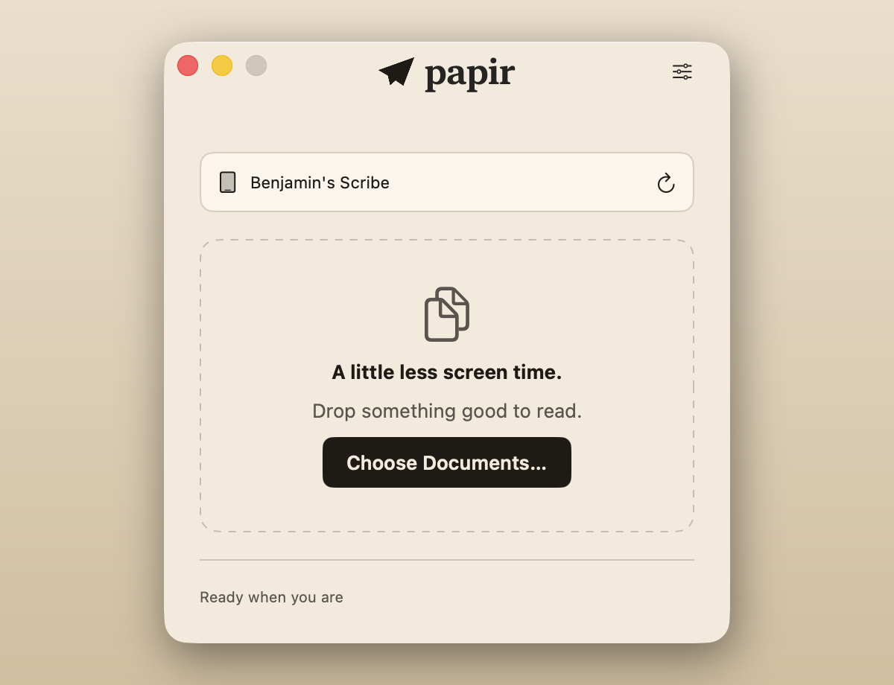

<p align="center">
  
</p>

<h1 align="center">Papir</h1>

<p align="center">
  <strong>A little less screen time.</strong><br>
  Beam reading material directly to your e-reader via API — from a native Mac app, a one-line command, or the Android share sheet.
</p>

<p align="center">
  <a href="https://github.com/duivesteyn/Papir/releases"></a>
  <a href="https://pypi.org/project/papir-kindle/"></a>
  
  
</p>

<p align="center">
  
</p>

Papir is Norwegian for *paper* — with **API** hidden in the middle. It sends PDFs, EPUBs, Word documents, text, HTML, Markdown and images to Kindle using the same private service as Amazon's Send to Kindle app.

> **Python CLI, native Mac app, Android share sheet.**
> `papir` is the Python CLI. The on-demand SwiftUI `Papir.app` in `macos/` bundles
> Python and browser sign-in, so Mac users need no Terminal at all.
> `android/` is a Kotlin app for the phone: share a PDF from any app and it lands
> on your Kindle. See [Mac setup](macos/README.md) and [Android notes](android/README.md).

**Unofficial.** Not affiliated with Amazon or Kindle. Papir speaks the private protocol used by Amazon's Send to Kindle desktop app (following `stkclient` by Max Johnson, MIT, and `cyrgim/stk`). Amazon can break it without notice — use it on an account you own.

## Why Papir

- **Native Mac app, zero setup.** The download includes its own Python runtime. Drag documents onto the window, review the batch, and send.
- **One tap from the share sheet.** The Android app takes a shared PDF straight to Kindle — no email, no app switching.
- **Correct Author and Title.** Documents arrive with the metadata you chose, not a mangled filename.
- **Defaults that stick.** Pick a default Kindle and author once; the CLI and Mac app share the same configuration.
- **Scriptable by design.** `papir send` writes only Amazon's SKU to stdout, so it drops cleanly into scripts and automations.
- **No middleman.** Papir talks directly to Amazon and keeps credentials on your Mac.

## Install

### Mac app

1. Download the ZIP for your Mac (Apple Silicon or Intel) from [Releases](https://github.com/duivesteyn/Papir/releases).
2. Extract it and drag `Papir.app` to Applications.
3. Open Papir, sign in with Amazon in your browser, then paste the final address back into the app.
4. Choose your default Kindle and author in Settings, drop a document, and send.

The release is ad-hoc signed and **not notarized**, so macOS may ask you to approve it under **System Settings → Privacy & Security → Open Anyway**. [Install notes](macos/INSTALL.md) have the details. The app targets macOS 14+. Early releases are marked as pre-releases while fresh-account/device-delivery and older-OS testing continues.

### Android

1. Download [papir-0.1.2.apk](https://github.com/duivesteyn/Papir/releases/download/android-0.1.2/papir-0.1.2.apk) on the phone and allow Chrome to install it — or build it from `android/` (`bash android/tools/build.sh`) and use `adb install -r android/build/papir-0.1.2.apk`.
2. Open Papir, sign in with Amazon (it opens in your browser), and choose your default Kindle.
3. Share any PDF → **Papir**. A small card confirms the send (and the SKU); failures offer Retry.

Android 8.0+. 0.1.2 is a sideload build signed with a local development key — no Play Store listing yet, and no Gradle. Details in [Android notes](android/README.md).

### Command line

```bash
pip install papir-kindle
papir login          # browser sign-in; set your default author and Kindle
papir send report.pdf
```

Requires Python 3.9+ and `pip`. The CLI and Mac app use the same credentials at `~/.config/papir/client.json` (mode 600), so signing in with either one signs in both.

## Everyday commands

```bash
papir login                                  # sign in, set default author + Kindle
papir login --url URL --verifier VERIFIER    # non-interactive (or --code CODE for a bare pasted code)
papir devices                                # SERIAL: Name (* marks the default)
papir devices --json                         # machine-readable devices + default
papir set-default                            # arrow-key/number picker (or `papir --set-default`)
papir set-default SERIAL                     # non-interactive (or `all` to clear)
papir set-default --author "deCapital"       # change the stored author
papir send report.pdf
papir send report.pdf --author "deCapital" --title "Imperial Investment Case" --to DEVICE_SERIAL
papir send report.pdf --convert              # convert PDF to Kindle format (default keeps native PDF)
papir document.pdf --title "Design Systems"  # shorthand, uses defaults
papir doctor [--live]                        # self-test; --live also checks Amazon
papir logout
```

`papir send` without `--to` uses your default Kindle, falling back to all devices. `--to` accepts a serial, `all`, or `library` (cloud library only, no device needed). `--format` overrides the detected file type (default `auto`); `--no-archive` skips saving to your Kindle library. `--client PATH` overrides the credential file.

### Supported formats

`PDF` · `EPUB` · `DOC` · `DOCX` · `RTF` · `TXT` · `HTM` / `HTML` · `MOBI` · `AZW` · `JPEG` · `PNG` · `GIF` · `BMP` · `MD`

PDFs stay native by default; pass `--convert` (or toggle **Convert PDF to Kindle format** in the app) to let Amazon convert them.

Markdown (`.md`, `.markdown`, `.mdown`, `.mkd`) is rendered to HTML on the way out — Amazon has no markdown intake, and HTML keeps the text reflowable. Headings, lists, links, quotes, fenced code and tables survive the trip; images that live next to the file cannot travel through the converter, so they arrive as their alt text. Drop a `.md` on the app, or run `papir send notes.md`.

## Python API

A runnable example is included in [`main.py`](main.py). In short:

```python
from papir import papirSend

sku = papirSend("report.pdf", author="deCapital", title="Imperial Investment Case", target="all")
print(sku)

# author/title optional — author falls back to your stored default, title to the filename:
sku = papirSend("report.pdf")
```

`papirSend` returns the SKU Amazon assigns:

```
8A47909664E246F0BAAB1738D7E9A154
```

## How it works

Papir registers itself as a Send-to-Kindle device, signs requests with a per-install serial, and uploads through Amazon's private API. There is no Papir server, no telemetry, and no Amazon password prompt — sign-in happens in your browser using PKCE. Accepted by the service means Amazon accepted the request; it does not confirm that a physical Kindle has downloaded the document.

The Mac app is a thin SwiftUI layer over the same Python engine. It adds drag-and-drop, batch sending, progress, browser sign-in and shared defaults. Everything else lives in `papir/`.

## Project layout

Everything for this mini project lives in this repository:

- `papir/`: Python CLI, protocol and shared sending engine.
- `macos/`: native Mac UI, bundling, verification and packaging.
- `android/`: Kotlin share-sheet app, protocol port, icons and tests.
- `planning/`: current plan and retained protocol/package research.
- `art/`: original icon master, fixed exports, asset catalog and style spec.
- `kindle_app_icon_pack.zip`: the Android marks — the launcher P fitted to the
  adaptive-icon safe zone, plus one Kindle silhouette per family — generated by
  `android/tools/make-icons.py`.
- `.github/workflows/`: offline CI and tagged Mac release builds.

Build environments and generated releases stay local and are ignored by Git. Downloadable binaries belong in GitHub Releases, not in source commits.

## Brand

**Ink on parchment** in the app (`#1F1B16` on `#F3EADB`), with the ivory paper plane on warm ink for the app icon (`#1F1B16` / `#F6EFE3`). Full spec: [art/Papir-art-style-spec.md](art/Papir-art-style-spec.md). The Mac app uses an on-demand parchment window and an ink plane mark beside its `papir` header; Android shares the same light surfaces. The CLI's only artwork is 📤/✅ in terminal output.

## Changelog

- macOS 2026-11-22 Mac app icon retoned from forest green to warm ink; the paper-plane artwork is unchanged.
- Mac/Android/web 2026-11-22 Ink-on-parchment interface: greens removed from window, settings, controls, intake page, extension options and Android surfaces; the app icon keeps the forest-green paper-plane art.
- macOS/Android/web 2026-11-22 v2 paper-plane icon suite: new app icon, favicons and Android launcher mark; the plane now sits beside the `papir` wordmark in the Mac window header.
- Android 0.1.2 2026-11-21 Share-sheet icon follows the Kindle selected in the app (Scribe, Paperwhite, Colorsoft, Oasis, Voyage, Basic, Keyboard, Touch, DX); the launcher mark is the artwork plane, resized so launcher masks no longer crop it.
- Android 0.1.2 2026-11-21 Share feedback card: progress, sent-with-SKU and Retry without opening the notification shade.
- Android 0.1.1 (unreleased) Browser-first sign-in with share-back/clipboard pickup, paste-friendly in-app fallback, share-sheet sends with SKU/Retry notifications.
- Android 0.1.0 (unreleased) Share-sheet target, native Kotlin protocol port, foreground sends with SKU/Retry notifications, in-app Amazon sign-in, sideload APK built without Gradle.
- v1.0 2026-10-17 Stable 1.0. Python package `papir-kindle` (`pip install papir-kindle`, CLI stays `papir`), Mac app + CLI.
- v0.2.2 2026-10-06 Forest-green native title bars across app windows.
- v0.2.0 2026-10-06 Self-contained native Mac app, browser sign-in/preferences, JSON desktop bridge, shared library-only default fix, consolidated planning/art and release builds.
- v0.1.1 2026-10-06 Native-PDF fix: dropped stkclient's invented `outputFormat=MOBI`/`deliveryMechanism` (backend converted PDFs), send `forceConvert:false` like the official app. Added `--convert` opt-in.
- v0.1.0 2026-10-06 Initial revision. login/devices/send/logout/doctor, correct Author+Title via DocumentMetadata.

## Python package

```bash
pip install papir-kindle
papir --help
```

Releases: pushing tag `v*` runs `.github/workflows/pypi.yml` — offline tests, `python -m build`, Trusted Publishing to PyPI as `papir-kindle`, then attaches `dist/*` to the GitHub Release. First publish needs a PyPI Trusted Publisher for this repo + workflow.

## Inspirations

- https://github.com/maxdjohnson/stkclient
- https://github.com/cyrgim/stk

## Credits

Designed in 2026 by bmd. Protocol work: `maxdjohnson/stkclient` (MIT) + `cyrgim/stk` (bare-digest signing quirk, per-install serials).

## Contributing

Contributions are welcome — see [CONTRIBUTING.md](CONTRIBUTING.md). For security reports, follow [SECURITY.md](SECURITY.md). Papir is released under the [MIT licence](LICENSE).
