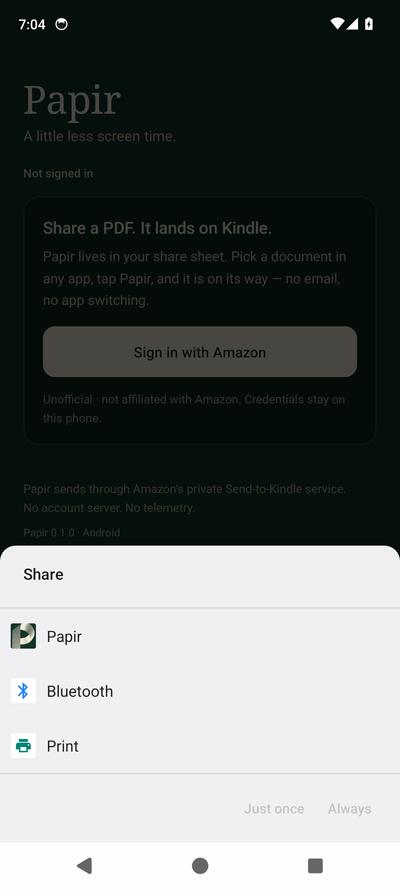
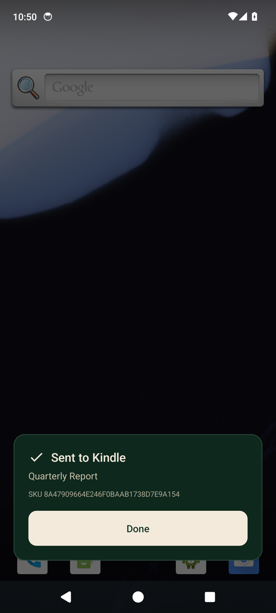
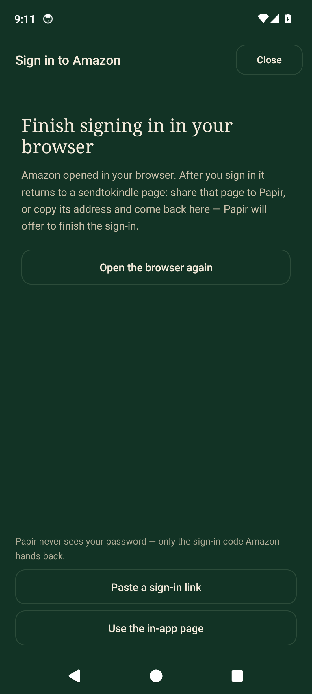
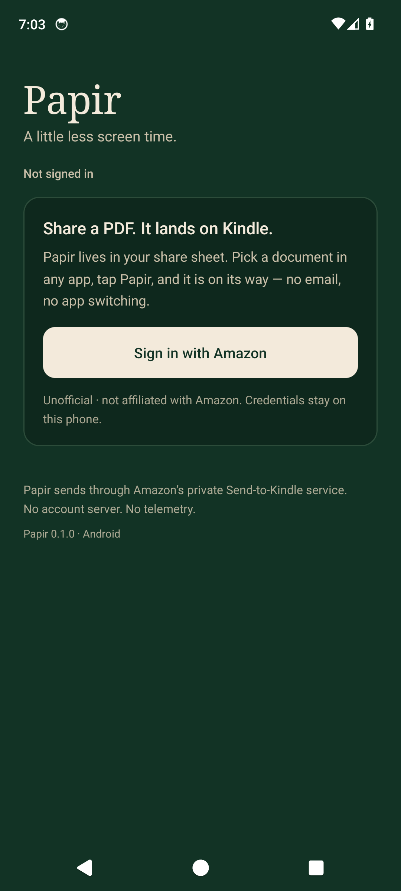

# Papir for Android

Papir in the share sheet: pick a PDF in any app, tap **Papir**, and it is on its
way to your Kindle. No email, no account server, no second app to switch to.

<p align="center">
  
  
  
  
</p>

The APK is a native Kotlin port of the same private Send-to-Kindle protocol the
CLI and Mac app use. One tap starts the upload; a card reports the SKU, or
offers **Retry**.

**Status:** 0.1.2 preview, sideload only. Android 8.0 (API 26) and later.
Checked on an Android 14 emulator: share-sheet entry, PDF intake, the share card
in its sending, sent, failed and sign-in states, foreground upload, and the
browser sign-in hand-off (including routing a shared sign-in page back into the
app). A live Amazon account and a real Kindle have not been used yet.

**Unofficial.** Not affiliated with Amazon. Amazon can change the protocol.

## What it does

- Adds **Papir** to the system share sheet for PDF, EPUB, DOC/DOCX, RTF, TXT,
  HTML, MOBI/AZW and images.
- Sends in a foreground service, so you can carry on reading in the app you
  shared from. A card shows progress and the outcome; the same result is
  mirrored in a notification if you dismiss it.
- Uses the defaults you set once: destination Kindle (or all devices), author,
  and a title cleaned from the file name — `Light_and_Wonder_Report_v1.2_2026-10-06.pdf`
  arrives as **Light and Wonder Report**.
- Plain-text shares become a `.txt` document. Links are refused for now:
  paginating a web page on the phone is a different job (see *Next*).
- The **Convert PDFs** switch mirrors the Mac app's opt-in. Off keeps the
  original page layout.

## Install

Build it (below) and install over USB:

```sh
adb install -r android/build/papir-0.1.2.apk
```

When 0.1.2 is tagged, the APK is attached to the GitHub release as well; opening
it on the phone asks you to allow installs from whichever app downloaded it.

Open Papir once, sign in, pick your Kindle. On Android 13+ the system also asks
for notification permission — without it Papir still sends, you just lose the
progress and confirmation notifications.

## Sign in

Sign-in happens in your browser — Chrome on most phones — like `papir login` on
the Mac: Papir opens Amazon's PKCE page there, where your password manager and
paste work normally. Papir never sees the password; it only receives the
authorization code Amazon hands back.

Amazon returns to `amazon.com/gp/sendtokindle`, which Android cannot pass to
Papir automatically — that would need Amazon to verify Papir as the owner of its
domain, which it does not. So the code comes back two ways:

- **Share the page to Papir.** After signing in, tap Share in the browser and
  pick Papir; the code in the page address finishes the login.
- **Copy the address and return.** Papir notices the link on the clipboard while
  the sign-in screen is open and offers to use it.

The in-app WebView is still there under **Use the in-app page**, with a small
script that lets the password field accept paste and autofill again. If neither
works, **Paste a sign-in link** accepts the final address by hand.

Amazon sees the phone as one more Send-to-Kindle device: a random per-install
serial and `Papir <model>` as the device name. Credentials are stored in the
app's private SharedPreferences and are removed when you sign out or uninstall.

## Everyday use

1. Open a PDF in any app — Files, Chrome, Gmail, a reader.
2. Share → **Papir**.
3. A card appears straight away: *Sending to Kindle* with progress, then
   *Sent to Kindle* with the SKU. It closes itself after a couple of seconds;
   **Hide** leaves the send running and the notification takes over.

Failures stay on the card with **Retry** and **Close**, and are mirrored in the
notification so they survive a dismissed card.

If you are not signed in yet, the first share opens sign-in and sends the
document as soon as it completes — the share is not lost.

## Settings

- **Destination** — one Kindle, or *All devices*. Refreshed from your account.
- **Author** — what the Kindle shelf shows; defaults to the Amazon account name.
- **Convert PDFs** — let Amazon reflow PDFs into Kindle format.

## Build

The app builds with the SDK's own tools (`aapt2`, `d8`, `apksigner`) and the
Kotlin compiler, driven by shell scripts — the same approach as `macos/build.sh`,
and no Gradle wrapper or build-system download. Requires a JDK 17+ (`openssl` only
for the fixture generator). Everything else is fetched into `.tooling/`
(gitignored):

```sh
bash android/tools/bootstrap.sh   # one time: Android SDK + Kotlin compiler
bash android/tools/build.sh       # -> android/build/papir-0.1.2.apk
bash android/tools/test.sh        # JVM tests
```

`test.sh` is more than a smoke test: the signing fixture is generated by
`papir/signer.py`, so the Kotlin signer has to produce byte-for-byte the digest
Amazon already accepts from the CLI. Regenerate it with:

```sh
python3 android/tools/make-fixtures.py
```

## How it works

```
share sheet ──▶ SendActivity ──▶ cache/inbox/<uuid>/<name>
                                     │
                                     ▼
                              UploadService (foreground, dataSync)
                                     │  PKCE token ─▶ api.amazon.com
                                     │  register  ─▶ firs-ta-g7g.amazon.com
                                     │  slot + PUT ─▶ stkservice + S3
                                     ▼
                              /SendToKindle ──▶ notification (SKU / Retry)
```

The protocol constants and call shapes mirror `papir/api.py`; the request
signature is PKCS#1 v1.5 over a **bare** SHA-256 digest, as in
`papir/signer.py`. No Papir server, no telemetry. The only network calls are to
Amazon and to the presigned upload URL Amazon returns.

The shared document is copied into the app's cache while the sending app's read
grant is still valid, sent from there, and deleted on success; anything left
behind by a crash or a cancelled share is swept after 24 hours. No storage
permission is needed.

## Layout

```
android/
  app/src/main/java/com/duivesteyn/papir/
    core/        protocol: Pkce, Signer, KindleApi, Sender, Config, Documents
    share/       sharesheet entry, payload parsing, upload service
    ui/          setup/settings and the browser sign-in hand-off
  app/src/main/res/     forest/ivory surfaces, adaptive icon, notification glyph
  app/src/test/         JVM tests (signer parity, PKCE, titles)
  tools/                bootstrap, build, test, fixture generator, icon maker
```

## Next

- Shared links → PDF, via Android's print pipeline, so Chrome shares work.
- Device list: cache it per account and refresh only on request, rather than
  each time the app opens.
- Import credentials from the Mac app (QR) for people who already signed in there.
- Play Store listing; 0.1.2 is a sideload build.

## Known limits

- The Android 15 foreground-service window is six hours; a send that has not
  finished by then is stopped by the OS.
- The full path to a live Kindle is unverified: signing matches the Python
  implementation byte for byte, and the phone's request reaches Amazon (a fake
  registration is rejected exactly as it should be), but no real account has
  sent a document from this app yet.
- Browser sign-in needs `www.amazon.com` reachable from the phone. If the
  share-back or clipboard hand-off doesn't land, the in-app page and the manual
  paste field are the fallbacks.
